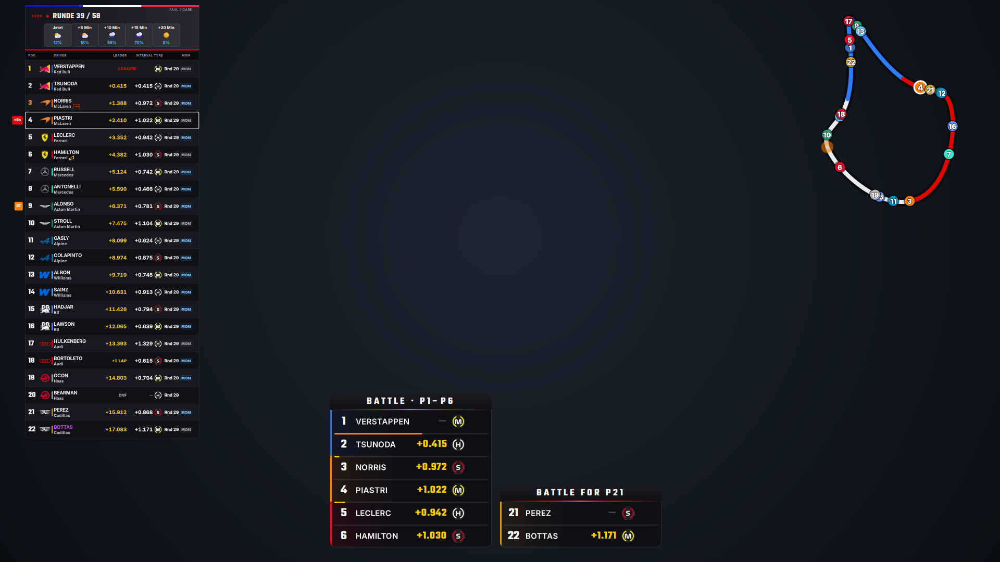
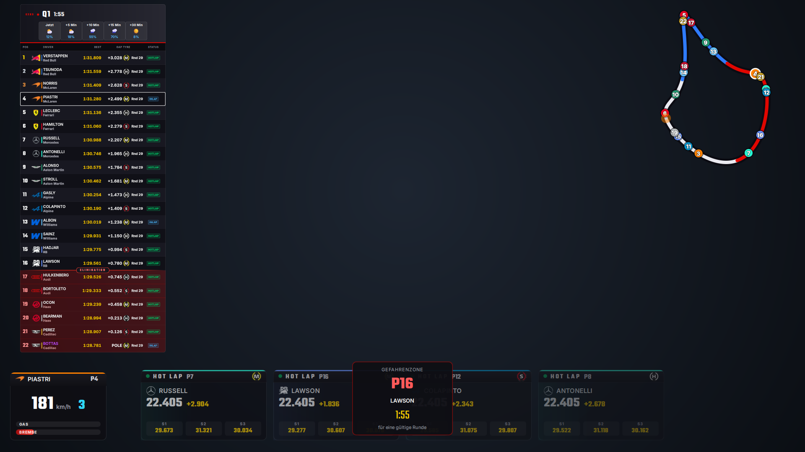
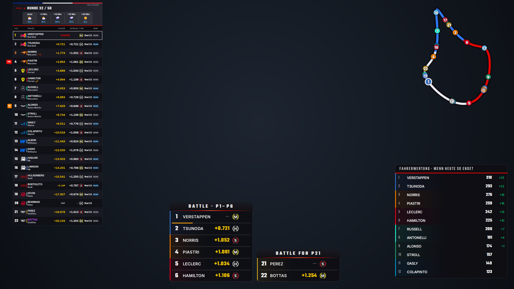
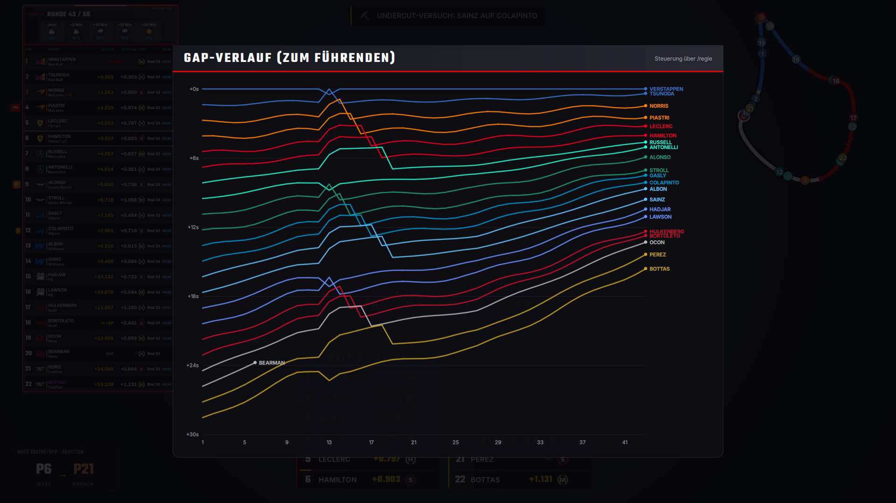
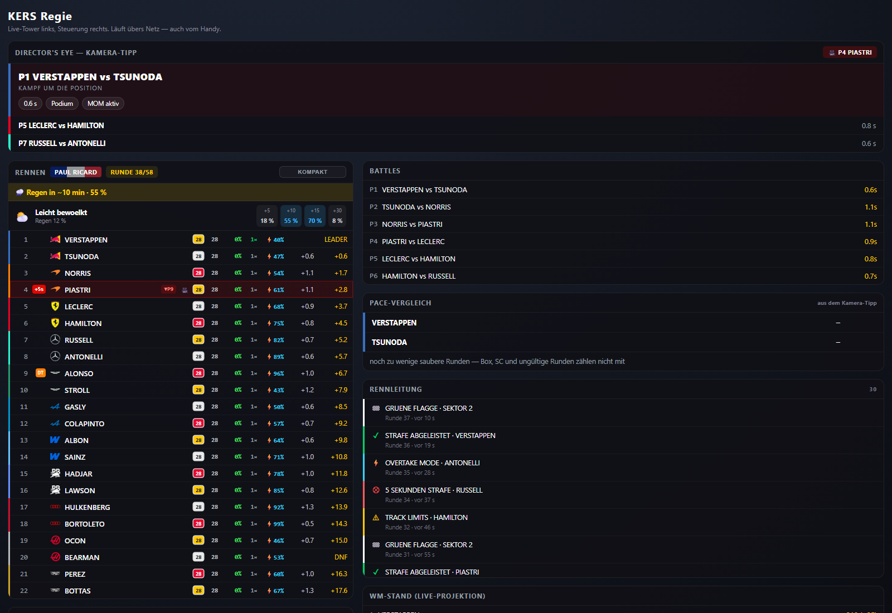
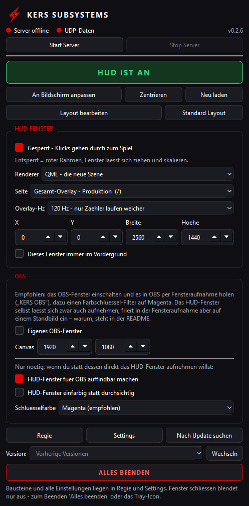
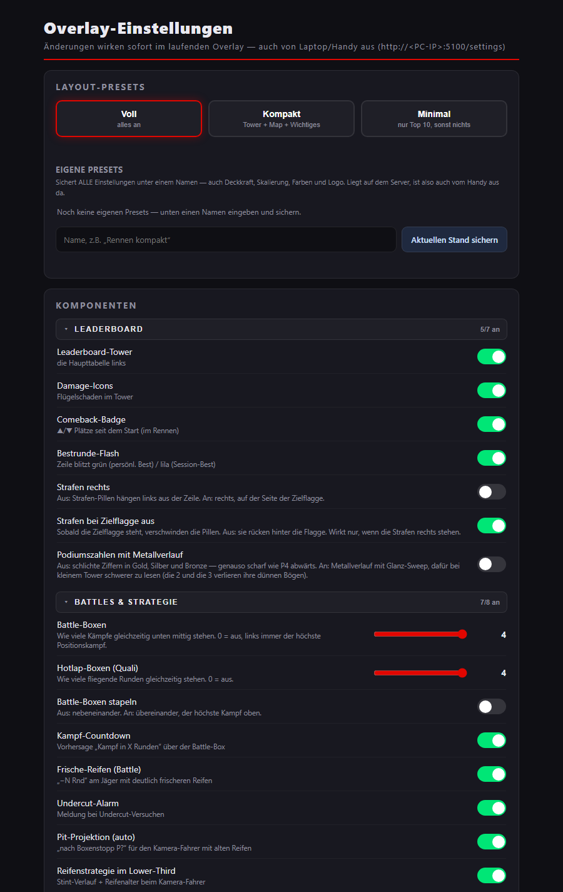

# KERS Subsystems

Live-Telemetrie-Overlay für **F1 26** — als Fenster über dem Spiel und als Quelle für OBS.

Das Programm hört auf den UDP-Strom des Spiels, rechnet daraus Abstände, Reifen,
Strafen und Kampfgruppen aus und zeigt sie als Bausteine an: Timing Tower,
Trackmap, Onboard, Lower-Third, Battle-Boxen, Boxenstopp-Karten, WM-Stand und
mehr. Jeder Baustein lässt sich einzeln abschalten und frei platzieren.

> Nur **F1 26** (UDP-Format „2026"). Ältere Spiele senden ein anderes Format und
> werden nicht gelesen.

**Seit 0.3.0 in C++.** Server und HUD laufen als *ein* Programm: eine einzelne
`KERS_Subsystems.exe` von rund 57 MB statt 243 MB, ohne Python, ohne Chromium,
ohne zweiten Prozess. Einstellungen, WM-Stände und Fensterlage aus 0.2.x werden
unverändert weiterbenutzt — siehe [Neu in 0.3.0](#neu-in-030).

---

## So sieht es aus



Das HUD im Rennen: Timing Tower mit Strafen-Pillen, Überrundeten und Ausfällen,
dazu die Trackmap und zwei Battle-Boxen.

| Quali | WM-Stand |
|:---:|:---:|
|  |  |
| Hotlap-/Inlap-Status, Eliminierungszone, Onboard, Hot-Lap-Boxen — und wer in der Gefahrenzone steht | Die Fahrerwertung, wie sie stünde, wenn das Rennen jetzt endet |

| Gap-Verlauf | Regie im Browser |
|:---:|:---:|
|  |  |
| Abstand zum Führenden über das ganze Rennen, eingeblendet aus der Regie | `/regie` — Kamera-Tipp, Live-Tower, Battles, Rennleitung und WM-Projektion |

<table>
  <tr>
    <th>Das Schaltbrett</th>
    <th>Einstellungen im Browser</th>
  </tr>
  <tr>
    <td align="center"></td>
    <td align="center"></td>
  </tr>
  <tr>
    <td align="center">Server starten, HUD an und aus, Layout bearbeiten, OBS</td>
    <td align="center"><code>/settings</code> — Presets, und jeder Baustein einzeln schaltbar</td>
  </tr>
</table>

> Die Overlay-Bilder zeigen das eingebaute Demo-Rennen (`KERS_Subsystems.exe --demo`) —
> erfundene Daten, keine Aufnahme aus dem Spiel.

---

## Schnellstart

1. Unter [Releases](https://github.com/KERSEX/KERS_Overlay/releases) die
   `KERS_Subsystems.exe` herunterladen und in einen eigenen Ordner legen.
2. Im Spiel unter **Einstellungen → Telemetrie** die UDP-Ausgabe einschalten:
   * UDP Telemetry: **On**
   * UDP Format: **2026**
   * IP: `127.0.0.1`, Port: `20777`
   * Fahrer `Spielernamen: AN`
3. `KERS_Subsystems.exe` starten. Es öffnet sich das Schaltbrett *KERS Subsystems*,
   der Server läuft dabei schon mit.
4. Beim ersten Start fragt die Windows-Firewall, ob das Programm im Netzwerk
   erreichbar sein darf. Für Handy und zweiten PC (Regie, Settings) **Private
   Netzwerke** erlauben; nur am eigenen Rechner geht es auch ohne.

Beim ersten Start legt die EXE daneben einen Ordner `data\` an. Dort liegen alle
deine Daten — Einstellungen, Fensterlage, WM-Stände, Aufzeichnungen. Die EXE
selbst enthält keine persönlichen Daten.

---

## Die beiden Fenster

**Das HUD** ist ein rahmenloses Fenster, das immer über allem liegt.
Im gesperrten Zustand gehen alle Klicks hindurch — du kannst also normal spielen,
während es über dem Bild liegt. Entsperrt lässt es sich verschieben und in der
Größe ändern.

**Das Schaltbrett** ist die Steuerung: Server starten und stoppen, HUD an und aus,
sperren, auf den Bildschirm legen, Layout, OBS und Updates. Der Knopf **Log**
zeigt, was Server und HUD melden — das, was früher im Konsolenfenster des
Servers stand. Dieselben Zeilen stehen in `data\kers.log`.
Es hat außerdem ein Symbol im Infobereich der Taskleiste.

---

## Bedienung im Browser

Läuft der Server, erreichst du diese Seiten unter `http://localhost:5100`
(vom Handy im selben WLAN über die IP des Rechners):

| Seite | Wofür |
|---|---|
| `/` | Das komplette Overlay als Browserquelle |
| `/regie` | Regie-Panel: Charts, WM-Stand, Battle- und Hotlap-Boxen von Hand ein- und ausblenden |
| `/settings` | Alle Einstellungen: Branding, Farben, Deckkraft, welche Bausteine sichtbar sind, Layout |

---

## Layout — Bausteine frei platzieren

Seit 0.2.0 bestimmst du selbst, wo jeder der 13 Bausteine sitzt.

**Mit der Maus:** im Schaltbrett auf **Layout bearbeiten**. Das HUD entsperrt sich
dabei selbst, alle Bausteine bekommen einen Rahmen mit Namen, und du ziehst sie an
ihren Platz. An den Ecken ziehst du sie größer und kleiner. Was gerade nichts
anzeigt (die Hotlap-Boxen laufen nur in der Quali) bekommt einen beschrifteten
Platzhalter, damit es trotzdem greifbar ist. Beendet wird oben mit **Fertig** oder
mit **Esc** — nicht im Schaltbrett, denn das liegt währenddessen unter der
bildschirmgroßen Klickfläche des HUD.

**Auf den Pixel genau:** in `/settings` gibt es zu jedem Baustein Regler für
Ankerpunkt, Versatz, Ebene und Größe.

**Was liegt vorn:** unter den Bausteinen steht die Liste **Ebenen** — oben liegt
vorn, mit den Pfeilen sortierst du um. Das ändert wirklich nur die Ebene: ein
Baustein, der noch auf *Standard* steht, behält seinen eingebauten Platz und
rechnet weiter mit (der Tower folgt der Strafen-Seite, die Trackmap ihrer
Position, die Pit-Projektion weicht dem Onboard aus).

**Bausteine** und **Ebenen** sind je ein Klappblock — einmal zugeklappt, bleibt es
zugeklappt, auch nach dem Neuladen. Im Kopf steht trotzdem, wie viele Bausteine
nicht mehr auf Standard stehen und ob die Reihenfolge eine eigene ist.

**Mehrere Anordnungen:** unter **Eigene Layouts** sicherst du die aktuelle
Anordnung unter einem Namen und holst sie mit einem Klick zurück — z.B. eine fürs
Rennen und eine für die Quali. Gesichert wird nur das Layout: Ankerpunkt, Versatz,
Ebene und Größe je Baustein. Farben, Deckkraft und Schalter bleiben unberührt,
dafür sind die *Presets* ganz oben da. Die Layouts liegen auf dem Server
(`data\layouts.json`), sind also auch vom Handy aus da.

**Zurück auf Anfang:** der Knopf **Standard Layout** neben *Layout bearbeiten*
stellt alle Bausteine wieder an ihren eingebauten Platz. Das betrifft nur die
Positionen — Branding, Farben und der Rest bleiben. Nur die Ebenen zurücksetzen
geht in `/settings` mit **Ebenen auf Standard**; Positionen und Größen bleiben
dabei stehen.

Ein Baustein hängt dabei nicht an festen Koordinaten, sondern an einem von neun
Ankerpunkten plus Versatz. Was du unten rechts platzierst, bleibt unten rechts,
auch wenn das Fenster eine andere Größe hat — praktisch, weil das HUD meist in
2560×1440 läuft und OBS in 1920×1080 aufnimmt.

---

## OBS

Zwei Wege:

* **Fensteraufnahme.** Das HUD kann ein zweites, undurchsichtiges Fenster für die
  Aufnahme öffnen. Damit OBS es überhaupt findet, im Schaltbrett *In OBS auffindbar*
  einschalten — sonst blendet OBS das Fenster aus.
* **Browserquelle.** `http://localhost:5100/` mit transparentem Hintergrund, oder
  einzelne Bausteine über `/part/<name>`.

Reicht deine Aufnahmemethode den Alphakanal nicht durch, gibt es die Rückfallebene
*Chroma*: das Overlay bekommt einen einfarbigen Hintergrund (Magenta, weil die
Farbe in einem Formel-1-Overlay nicht vorkommt), den du in OBS per Farbschlüssel
wegfilterst.

---

## Selbst-Update

Beim Start sieht das Programm still nach, ob es eine neuere Fassung gibt, und
meldet sich mit einem Knopf. Der Download wird gegen Größe und SHA-256 geprüft,
bevor er die laufende Datei ersetzt; die alte bleibt als Rückfallebene liegen,
bis die neue einmal gestartet ist. Du kannst im Schaltbrett auch gezielt eine
andere Fassung wählen — auch zurück auf eine Python-Fassung 0.2.x.

Von 0.2.6 kommt man ganz normal über den Update-Knopf auf 0.3.0. Die C++-Fassung
räumt beim ersten Start die alte 243-MB-Datei (`KERS_Subsystems.exe.bak`) weg.
Der Server der alten Fassung (`data\main.exe` mit seinem Konsolenfenster) läuft
nach dem Tausch noch weiter — 0.3.0 beendet ihn vor dem eigenen Serverstart von
selbst, aber nur genau diesen aus dem eigenen Ordner.

---

## Neu in 0.3.0

* **Ein Programm statt zwei.** Der Server läuft im selben Prozess wie das HUD.
  Das HUD bekommt seine Daten direkt, Browser, Handy und OBS weiter über
  `http://<PC>:5100`. Ein eigenes Konsolenfenster gibt es nicht mehr, dafür das
  Log im Schaltbrett.
* **Der Server startet mit.** Abschalten lässt sich das in `data\hud_state.json`
  mit `"server_autostart": false` oder beim Start mit `--no-server`. Die Knöpfe
  *Start Server* und *Stop Server* bleiben.
* **Kein Browser geht mehr von selbst auf.** Regie und Settings öffnest du über die
  Knöpfe im Schaltbrett.
* **Die Renderer-Auswahl ist weg.** Das HUD ist nur noch die QML-Szene; die alten
  HTML-Seiten gibt es weiter als Browserquelle.
* **Trackmap nach Session-Wechsel.** Bisher war die Karte einer bekannten Strecke
  nach dem Wechsel von der Quali ins Rennen leer, bis man die Strecke wechselte.
  Jetzt bleibt sie stehen.
* **Eine Quelle auf dem UDP-Port.** Der Server belegt Port 20777 exklusiv. Läuft
  noch ein zweiter Server (z.B. die alte Python-Fassung), meldet das Schaltbrett
  „Port belegt", statt dass sich zwei Programme die Pakete teilen.

---

## Aus dem Quelltext bauen

C++20 mit Qt 6.11, statisch gelinkt — das Ergebnis ist eine einzelne EXE ohne DLLs.
Das Werkzeug liegt portabel unter `D:\Tools` und `D:\Qt`, installiert wird nichts:

| Was | Wo |
|---|---|
| LLVM-MinGW (clang, lld) | `D:\Tools\llvm-mingw` |
| CMake, Ninja | `D:\Tools\cmake`, `D:\Tools\ninja` |
| Qt 6.11.2 statisch (qtbase, qtshadertools, qtdeclarative) | `D:\Qt\6.11.2-static` |

Das statische Qt baut `tools\build_qt_static.cmd` einmalig aus den Quellen
(rund 15 Minuten). Danach:

```bat
packaging\build.bat
```

Ergebnis: `build\KERS_Subsystems.exe`. Die Tests laufen mit

```bat
packaging\env.bat
ctest --test-dir build --output-on-failure
```

Für eine Veröffentlichung legt `packaging\release.bat` die EXE samt SHA-256 in
`dist\` ab.

**Startoptionen**

| Option | Wirkung |
|---|---|
| `--demo` / `--demo quali` | erfundenes Rennen, ohne Spiel und ohne Server |
| `--url http://…:5100` | keinen eigenen Server starten, sondern einen anderen beobachten |
| `--server` | nur der Server, ohne HUD (mit Tray-Icon) |
| `--no-server` | den eingebauten Server nicht automatisch starten |
| `--port N`, `--udp-port N` | andere Ports (Vorgabe 5100 und 20777) |
| `--obs`, `--chroma`, `--unlocked`, `--no-panel`, `--hz N` | wie bisher |
| `--qml-dir <Ordner>` | die Szene aus Dateien statt aus der EXE laden — zum Bauen am QML |

Der Golden-Vergleich mit der Python-Fassung liegt in `tests\golden\`: eine
`.f1rec`-Aufnahme läuft einmal durch `main.py` und einmal durch `kers_replay`,
`vergleich.py` legt die Ergebnisse nebeneinander.

---

## Aufbau

```
src/server/     UDP-Parser, Rennzustand, HTTP/SSE-Server, Routen, Recorder,
                Kamera-Tasten, Streckenkonturen, Settings    (früher main.py)
src/hud/        Theme, Modelle, Bausteine, Datenstrom, HUD- und OBS-Fenster
                                                              (früher hud/*.py)
src/app/        main.cpp, Schaltbrett, Tray, Updater, Log-Fenster
src/common/     Pfade (data\), JSON-Dateien, Log, hud_state.json
hud/qml/        die Overlay-Szene — dieselben QML-Dateien wie in 0.2.x
templates/, static/   Web-Overlay, Regie und Einstellungen — in die EXE eingebettet
tests/          Qt-Tests (ctest) und der Golden-Vergleich
main.py, hud/*.py     die Python-Fassung 0.2.6, nur noch als Vorlage
```

Ports: **5100** für die Weboberfläche, **20777** für die UDP-Pakete des Spiels.

> Beim Testen darf nur **eine** Quelle auf 20777 senden — entweder das echte Spiel
> oder ein Testsender. Sonst mischen sich die Daten. `Test\test.py --port 20778`
> schickt an einen anderen Port.

---

## Fehlersuche

**Nichts kommt an.** Prüfe im Schaltbrett die Statuszeile: sie zeigt getrennt, ob
der Server läuft und ob UDP-Pakete ankommen. Sendet das Spiel ein anderes Format
als 2026, kommen Pakete an, werden aber nicht gelesen.

**Das HUD liegt hinter dem Spiel.** Im randlosen Vollbild schiebt sich das Spiel
manchmal nach vorn. Das HUD meldet sich alle zwei Sekunden von selbst wieder oben
an; hilft das nicht, ist meist das Spiel im echten Vollbild — dann ist die
Browserquelle in OBS der bessere Weg.

**OBS findet das Fenster nicht.** *In OBS auffindbar* einschalten. Dafür erscheint
das HUD dann auch in der Taskleiste.

**„Port belegt" beim Start.** Auf 5100 oder 20777 läuft schon etwas — meist eine
alte Python-Fassung aus einem anderen Ordner (`main.exe` bzw. `main.py`) oder ein
zweites KERS. (Den `data\main.exe` aus dem eigenen Ordner beendet 0.3.0 selbst.)
Das andere Programm beenden, dann im Schaltbrett **Start Server**.

**Handy erreicht die Regie nicht.** Beim ersten Start hat die Windows-Firewall
gefragt; wurde dort abgelehnt, in den Firewall-Einstellungen
`KERS_Subsystems.exe` für *Private Netzwerke* freigeben.

---

## Lizenz und Zugehörigkeit

Privates Projekt, kein offizielles Produkt von EA oder Codemasters. Alle Marken
gehören ihren jeweiligen Eigentümern.

Der eigene Quelltext steht unter der MIT-Lizenz (`LICENSE.txt`). Die EXE enthält
statisch gelinkt **Qt 6** (LGPL-3.0, https://www.qt.io/licensing) und dessen
mitgelieferte Bibliotheken (zlib, libpng, libjpeg, FreeType, HarfBuzz, PCRE2).
Weil der gesamte Quelltext offen liegt, lässt sich die EXE mit einer anderen
Qt-Fassung neu bauen, wie es die LGPL verlangt.
